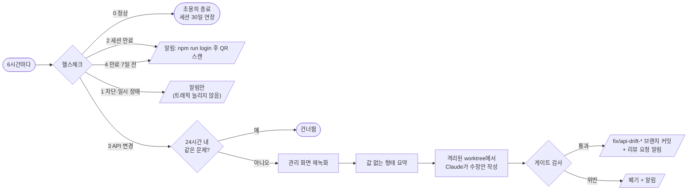
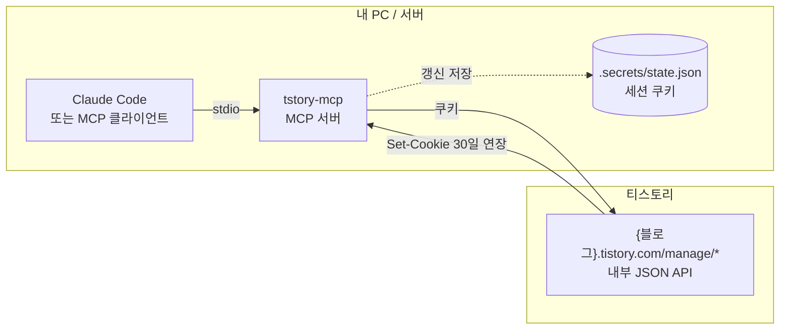

<div align="center">

# tstory-mcp

**API가 없는 티스토리에 API를 만들어, Claude가 블로그를 직접 쓰게 하는 MCP 서버**

"이 마크다운 비공개로 올려줘" 한마디로 이미지 업로드부터 발행까지.<br>
아이디·비밀번호 없이 카카오톡 QR 한 번이면 로그인되고, 티스토리가 바뀌면 스스로 알아챕니다.


</div>

---

## 목차

- [왜 만들었나](#왜-만들었나)
- [무엇을 할 수 있나](#무엇을-할-수-있나)
- [빠른 시작](#빠른-시작)
- [사전 요구사항](#사전-요구사항)
- [설치 자세히](#설치-자세히)
- [로그인: 카카오톡 QR](#로그인-카카오톡-qr)
- [사용법](#사용법)
- [서버에서 자동 운영하기](#서버에서-자동-운영하기)
- [동작 원리](#동작-원리)
- [보안 설계](#보안-설계)
- [문제 해결](#문제-해결)
- [개발](#개발)
- [주의사항](#주의사항)

---

## 왜 만들었나

티스토리 Open API는 종료됐습니다. 그래서 글을 자동으로 올리려면 브라우저를 매크로로 조작하거나, 아이디·비밀번호를 도구에 맡겨야 했습니다.

그런데 티스토리 관리자 화면도 결국 **내부 JSON API**를 호출합니다. 이 프로젝트는 요즘 많이 쓰는 *"API 없는 사이트에서 API 뽑아내기"* 방식으로 만들었습니다.

1. 브라우저로 관리자 화면을 한 번 써 보면서 네트워크 요청을 **HAR로 녹화**합니다.
2. 녹화에서 진짜 API(글 목록, 발행, 임시저장, 이미지 업로드 …)를 골라 [명세](recordings/ENDPOINTS.md)로 정리합니다.
3. 그 요청을 **브라우저 없이 쿠키만으로** 재현하는 클라이언트를 만들고, MCP 도구로 감쌉니다.
4. 티스토리가 내부 API를 바꿀 수 있으니, **주기적으로 계약을 점검하고 바뀌면 다시 녹화해 수정안을 만드는 배치**까지 붙였습니다.

## 무엇을 할 수 있나

| | |
|---|---|
| ✍️ **글쓰기** | 마크다운 → 티스토리 HTML 변환, 본문의 로컬 이미지 자동 업로드, 카테고리 이름으로 지정, 태그 |
| 📚 **관리** | 글 목록·검색·조회·수정·삭제, 카테고리, 임시저장 |
| 🔐 **QR 로그인** | 카카오톡으로 QR만 스캔. ID/PW를 어디에도 입력하지 않음. SSH 터미널에서도 QR이 그려짐 |
| ♻️ **세션 자동 연장** | "로그인 상태 유지" 30일 세션을 쓸 때마다 다시 30일로 연장 |
| 🩺 **헬스체크** | 내부 API 계약을 주기적으로 검증, 세션 만료·임박 시 두레이 알림 |
| 🛠 **자가복구** | API가 바뀌면 재녹화 → 격리된 환경에서 Claude가 수정안 브랜치 작성 → 사람이 리뷰·머지 |
| 🛡 **안전 기본값** | 발행 기본 **비공개**, 삭제·공개 전환은 `confirm` 필수, 숨김 파일 업로드 차단 |

## 빠른 시작

```bash
git clone https://github.com/seunggulee1007/tstory-mcp.git tstory-mcp && cd tstory-mcp
npm run setup -- --login --mcp=~/work/my-blog     # 블로그 글을 쓸 프로젝트 경로
```

이 한 줄이 다음을 순서대로 합니다.

1. Node·npm·git·Claude Code를 확인합니다.
2. 의존성과 헤드리스 브라우저를 설치하고 빌드합니다.
3. 터미널에 **QR을 띄웁니다**. 카카오톡으로 스캔하세요.
4. **지정한 프로젝트에서만** 쓰이도록 Claude Code에 `tistory` MCP 서버를 등록합니다.

설치가 끝나면 그 프로젝트에서 **새 Claude Code 세션**을 열고 이렇게 말해 보세요.

> 내 티스토리 최근 글 5개 보여줘

## 사전 요구사항

| 필요한 것 | 버전 | 용도 |
|---|---|---|
| **Node.js** | 22.12 이상 (권장 24 LTS) | 실행 환경 |
| **git** | 아무 버전 | 설치, 자가복구 배치의 수정안 브랜치 |
| **Claude Code** | 최신 | MCP 클라이언트, 자가복구 수정안 작성 (Claude Desktop 등 다른 MCP 클라이언트로 대체 가능) |
| **카카오톡 앱** | - | QR 로그인 (휴대폰) |
| 티스토리 블로그 | - | 카카오 계정으로 로그인하는 블로그 |

> 헤드리스 브라우저(Chrome for Testing)는 `npm run setup`이 알아서 설치합니다. 따로 준비할 필요가 없습니다.

### 한 번에 설치하기

**macOS: Homebrew** (저장소의 [`Brewfile`](Brewfile) 사용)

```bash
brew bundle            # node + git + claude-code 를 한 번에
```

**Linux / macOS 공통: [mise](https://mise.jdx.dev)로 Node 설치 + 공식 설치 스크립트로 Claude Code 설치**

```bash
curl https://mise.run | sh && mise use -g node@24
curl -fsSL https://claude.ai/install.sh | bash
```

> Claude Code는 Pro·Max·Ultra·Team·Enterprise 또는 Console(API) 계정이 필요합니다. 설치 후 `claude`를 한 번 실행해 로그인하세요.

## 설치 자세히

`npm run setup`은 여러 번 실행해도 안전합니다. 이미 끝난 단계는 건너뜁니다.

| 명령 | 하는 일 |
|---|---|
| `npm run setup` | 요구사항 확인 → `npm ci` → Chrome for Testing 설치 (Linux는 시스템 라이브러리 포함) → 빌드 → `.secrets/`(700)·`.env` 준비 |
| `npm run setup -- --login` | + 카카오 QR 로그인 |
| `npm run setup -- --mcp=<프로젝트 경로>` | + 그 프로젝트에서만 쓰도록 `tistory` MCP 등록 (local 범위, **권장**) |
| `npm run setup -- --mcp-global` | + 모든 프로젝트에서 쓰도록 등록 (user 범위) |
| `npm run setup -- --cron` | + 6시간마다 배치 실행 크론 등록 (서버용) |

> **왜 프로젝트별 등록을 권장하나요?** 전역으로 등록하면 회사 업무 프로젝트를 포함한 **모든** Claude Code 세션에 블로그 쓰기 도구가 노출됩니다. 업무 대화 중에 실수로 블로그에 글이 올라가거나, 업무 내용이 블로그 도구로 흘러갈 여지를 아예 없애려면 블로그를 쓰는 프로젝트에만 등록하세요.
>
> local 범위 등록 정보는 `~/.claude.json`의 해당 프로젝트 항목에만 저장되고, 그 프로젝트 저장소에는 아무 파일도 생기지 않습니다(`.mcp.json`을 쓰는 project 범위와 다름). 공개 저장소에서도 안심하고 쓸 수 있습니다.

<details>
<summary><b>수동으로 설치하고 싶다면</b></summary>

```bash
npm ci
npx agent-browser install            # Linux: npx agent-browser install --with-deps
npm run build
cp .env.example .env
npm run login

# 블로그 글을 쓸 프로젝트 안에서 local 범위로 등록
TSTORY="$PWD"
cd ~/work/my-blog
claude mcp add tistory -s local \
  -e TISTORY_STATE_FILE="$TSTORY/.secrets/state.json" \
  -- node "$TSTORY/dist/src/server.js"
```

</details>

<details>
<summary><b>Claude Desktop 등 다른 MCP 클라이언트에 등록</b></summary>

`claude_desktop_config.json`(또는 클라이언트의 MCP 설정)에 추가합니다. 경로는 **절대경로**로 적으세요.

```json
{
  "mcpServers": {
    "tistory": {
      "command": "node",
      "args": ["/절대경로/tstory-mcp/dist/src/server.js"],
      "env": {
        "TISTORY_STATE_FILE": "/절대경로/tstory-mcp/.secrets/state.json"
      }
    }
  }
}
```

</details>

## 로그인: 카카오톡 QR

```bash
npm run login              # 터미널에 QR 표시 (SSH 접속 중에도 동작)
npm run login -- --open    # macOS: QR 이미지를 미리보기로도 열기
npm run login -- --headed  # 브라우저 창을 눈으로 보면서 진행
```

```
카카오 QR 로그인을 시작합니다. (아이디/비밀번호는 입력하지 않습니다)

카카오톡 앱 안의 스캐너로 아래 QR 코드를 스캔하세요 (약 5분간 유효).
카카오톡 → 더보기 → 우측 상단 스캔 버튼. 아이폰 기본 카메라로 찍으면 열리지 않습니다.

 ▄▄▄▄▄▄▄  ▄  ▄▄  ▄  ▄   ▄   ▄ ▄▄▄▄   ▄ ▄▄▄▄▄▄▄
 █ ▄▄▄ █ ▄██▀▄▄▄██▀▄ ▀▀▀███▄▄█▄  ██ █  █ ▄▄▄ █
 ...
```

**카카오톡 → 더보기 → 우측 상단 스캔 버튼**으로 찍으면 끝입니다. 아이폰 기본 카메라로 찍으면 "SpringBoard에서 여시겠습니까?"가 뜨고 로그인되지 않습니다.

- 브라우저가 카카오 QR 로그인 화면으로 이동해 **"로그인 상태 유지"를 자동으로 체크**합니다.
- QR은 약 5분간 유효합니다. 만료되면 자동으로 새로 그립니다 (최대 3회).
- 세션은 `.secrets/state.json`(권한 600)에 저장되고, 브라우저는 항상 닫힙니다.

### 얼마나 자주 다시 로그인해야 하나요?

거의 하지 않아도 됩니다.

- "로그인 상태 유지"로 받은 세션은 **30일**입니다.
- 내 블로그 목록 API를 호출할 때마다 티스토리가 만료를 **다시 30일 뒤로** 미뤄 줍니다.
- MCP 서버는 시작할 때와 6시간마다, 헬스체크는 실행할 때마다 이 API를 부릅니다.
- 그래서 **배치가 돌고 있는 한 세션은 끊기지 않습니다.**

다시 로그인해야 하는 경우는 배치가 30일 넘게 멈췄을 때, 그리고 카카오 비밀번호 변경이나 보안 조치로 세션이 무효화됐을 때입니다. 이때는 두레이 알림이 오니 `npm run login`만 다시 하면 됩니다.

> 사람 없이 자동으로 다시 로그인하는 것은 불가능합니다. 티스토리가 매번 카카오 계정 확인(`prompt=select_account`)을 요구하기 때문입니다. 그래서 위처럼 **끊기지 않게 연장하는 방식**을 택했습니다.

## 사용법

### Claude에게 이렇게 말하세요

```text
내 티스토리 카테고리 목록 보여줘
'Claude' 키워드로 쓴 글 찾아줘
./posts/mcp-후기.md 를 "개발" 카테고리에 비공개로 올려줘. 태그는 MCP, Claude
방금 올린 글 제목을 "MCP 써보니"로 바꿔줘
임시저장 목록 보여주고 오래된 건 지워줘
```

마크다운 본문에 `` 같은 **로컬 이미지**가 있으면 자동으로 업로드한 뒤 티스토리 이미지 형식으로 바꿔 넣습니다.

### 제공 도구

| 도구 | 설명 | 안전장치 |
|---|---|---|
| `tistory_whoami` | 내 블로그 목록, 현재 블로그 | |
| `tistory_list_posts` | 글 목록 (페이지, 검색어, 카테고리, 공개범위) | |
| `tistory_get_post` | 글 한 건 (본문 HTML, 태그) | 보호글 비밀번호는 반환하지 않음 |
| `tistory_list_categories` | 카테고리 (하위 포함, 경로 표시) | |
| `tistory_create_category` | 카테고리 생성 (이름, 선택적 부모 id·이름) | 2단계까지만 지원 — 부모는 최상위여야 하며 이름에 `/` 불가 |
| `tistory_publish_post` | 발행 (마크다운/HTML, 카테고리 이름·id, 태그) | **기본 비공개**, 캡차로 막히면 임시저장으로 대체 |
| `tistory_update_post` | 지정한 필드만 수정 | 공개·보호로 바꿀 때 `confirm: true` 필요 |
| `tistory_delete_post` | 삭제 | `confirm: true` 필요 |
| `tistory_list_drafts` · `tistory_save_draft` · `tistory_delete_draft` | 임시저장 | |
| `tistory_upload_image` | 로컬 이미지 업로드 → 본문용 치환자 반환 | 숨김 경로·`.secrets`·10MB 초과·이미지 아닌 파일 거부 |

### 환경 변수

`.env`(배치용) 또는 MCP 등록 시 `-e`로 지정합니다.

| 변수 | 기본값 | 설명 |
|---|---|---|
| `TISTORY_STATE_FILE` | `.secrets/state.json` | 세션 파일. MCP 등록 시에는 **절대경로** 권장 |
| `TISTORY_BLOG` | 기본 블로그 | 블로그가 여러 개일 때 사용할 블로그 이름 |
| `NOTIFY_WEBHOOK_URL` | (없음 → 표준출력) | 두레이 인커밍 웹훅 URL |
| `HEALTHCHECK_UPLOAD` | `0` | `1`이면 헬스체크가 이미지 업로드도 검사. 업로드한 파일이 남으니 주 1회 정도만 권장 |
| `REPAIR_PUSH` | `0` | `1`이면 수정안 브랜치를 origin에 push |
| `REPAIR_MAX_BUDGET_USD` | `3` | 수정안 작성 1회당 Claude 비용 상한 |

## 서버에서 자동 운영하기

비공식 API는 언제든 바뀔 수 있습니다. 서버에 배치를 걸어 두면 **세션을 계속 연장하고, API가 바뀌면 알아채서 수정안까지** 만들어 둡니다.

```bash
# 서버에서
git clone https://github.com/seunggulee1007/tstory-mcp.git tstory-mcp && cd tstory-mcp
npm run setup -- --login --cron     # QR은 SSH 터미널에 그대로 뜹니다
vi .env                             # NOTIFY_WEBHOOK_URL 입력
```

> 💡 로그인은 **서버에서 직접** 하세요. 다른 PC의 세션 파일을 복사하면 카카오가 새 기기로 보고 막을 수 있습니다.

### 배치가 하는 일



| 종료 코드 | 의미 | 배치 동작 |
|:-:|---|---|
| `0` | 모든 검사 통과 | 조용히 종료 |
| `2` | 세션 만료 (로그인으로 리다이렉트) | "세션 만료, 서버에서 `npm run login` 후 QR 스캔" 알림 |
| `4` | 통과했지만 세션이 7일 안에 만료됨 (연장이 멈춤) | "세션 만료 임박" 알림 |
| `1` | 403·429 차단·요청 제한, 네트워크·5xx 등 | 알림만. 재녹화나 수정을 하지 않음 |
| `3` | API 계약 변경 (응답 형태 불일치, 그 외 4xx) | 재녹화 → 수정안 브랜치 |

헬스체크는 다음을 확인합니다. **글 발행·수정·삭제는 하지 않습니다.** 발행하면 글 번호가 영구히 소모되기 때문입니다.
- 내 블로그 목록 (세션 연장 포함)
- 글 목록, 카테고리, 임시저장 목록, 글 한 건 조회
- 임시저장 생성 → 삭제
- 이미지 업로드 (선택)

### 수정안이 오면

배치는 수정안을 **제안만** 합니다. 머지와 실행은 사람이 합니다.

```bash
git diff main..fix/api-drift-<날짜>-<서명>            # 1) 먼저 diff 를 읽고
git switch fix/api-drift-<날짜>-<서명>
npm run typecheck && npm test && npm run healthcheck  # 2) 직접 검증한 뒤
git switch main && git merge fix/api-drift-<날짜>-<서명>
```

알림에 **"⚠ 위험 패턴 N건"**이 붙어 있으면 diff를 특히 꼼꼼히 보세요. 파일 읽기, 외부 주소 접속처럼 블로그 API와 상관없는 코드가 추가됐다는 뜻입니다.

## 동작 원리



- **인증은 쿠키뿐입니다.** 브라우저처럼 보이는 헤더도 필요 없습니다(녹화 후 헤더를 하나씩 빼 보며 확인).
- 사용하는 엔드포인트, 요청과 응답 형태는 [`recordings/ENDPOINTS.md`](recordings/ENDPOINTS.md)에 정리돼 있습니다.
- 응답은 모두 [zod 스키마](src/schemas.ts)로 검증합니다. 형태가 바뀌면 바로 "계약 위반"으로 잡혀 헬스체크가 알아챕니다.

## 보안 설계

세션 쿠키는 **계정 비밀번호와 같은 무게**로 다룹니다.

- **ID/PW를 받지 않습니다.** QR로만 로그인합니다.
- **세션 파일 보호**
  - `.secrets/`는 권한 700, `state.json`은 600입니다.
  - 여러 프로세스가 동시에 써도 깨지지 않게 잠금 → 최신본 다시 읽기 → 원자적 교체 순서로 저장합니다.
  - 티스토리 도메인 쿠키만 저장합니다. 카카오 계정 쿠키는 쓰지 않으므로 저장하지 않으며, 예전 `state.json`에 남아 있으면 `npm run prune-cookies`로 한 번 정리할 수 있습니다.
  - 새로 로그인하면 오래 떠 있는 MCP 서버도 새 세션을 바로 가져다 씁니다.
- **녹화본 보호**
  - 원본 HAR에는 쿠키가 들어 있어 git에서 제외하고 권한 600으로 둡니다.
  - 요약본에는 **값 없이 키와 형태만** 남깁니다. 다른 블로거의 글이나 댓글 알림 같은 외부 콘텐츠가 섞이는 API는 아예 넣지 않습니다.
- **자동 수정 단계 격리** (외부 보안 리뷰 반영)
  - 세션 파일이 없는 임시 `git worktree`에서 실행합니다. 환경변수는 `HOME`, `PATH`만 넘기고, 명령어 실행·웹 접근 도구는 뺍니다. 훅과 MCP도 끈 상태입니다.
  - 끝나면 신뢰된 코드로 다음을 검사합니다.
    - 허용된 파일만 바뀌었는지
    - 심볼릭 링크나 git 파일 변조가 없는지
    - 쿠키 값이 들어가지 않았는지
    - 저장소의 다른 파일이 몰래 바뀌지 않았는지
  - **모델이 쓴 코드는 자동으로 실행하지 않습니다.**

## 문제 해결

<details>
<summary><b>QR이 만료됐어요 / 스캔했는데 반응이 없어요</b></summary>

"SpringBoard에서 여시겠습니까?"가 떴다면 기본 카메라로 찍은 것입니다. 카카오톡 앱 안의 스캔 버튼으로 다시 찍으세요.

QR은 약 5분 유효하며 자동으로 3번까지 새로 그립니다. 그래도 안 되면 `npm run login`을 다시 실행하세요. 화면을 직접 보고 싶다면 `npm run login -- --headed`를 쓰세요.
</details>

<details>
<summary><b>"세션 만료" 알림이 왔어요</b></summary>

배치가 돌던 서버에서 `npm run login`을 실행하고 QR을 스캔하세요. 실행 중인 MCP 서버는 재시작하지 않아도 새 세션을 가져다 씁니다.
</details>

<details>
<summary><b>발행했는데 임시저장으로 저장됐다고 해요</b></summary>

티스토리가 발행 시 캡차를 요구한 경우입니다. 티스토리 글쓰기 화면에서 임시저장 글을 열어 직접 발행하세요.
</details>

<details>
<summary><b>종료 코드 1, "차단/요청 제한 가능성"</b></summary>

티스토리가 403·429로 요청을 막은 상태입니다. 배치는 이때 일부러 아무것도 더 하지 않습니다. 시간이 지나면 보통 풀립니다. 크론 주기를 너무 짧게 잡지 마세요(6시간 권장).
</details>

<details>
<summary><b>Chrome for Testing 프로세스가 남아 있어요</b></summary>

`npm run cleanup`을 실행하세요. 30분 넘게 남은 이 도구의 브라우저만 골라 정리합니다. 평소 쓰는 Chrome은 건드리지 않습니다. 배치는 시작할 때 이걸 자동으로 실행합니다.
</details>

<details>
<summary><b>Linux에서 브라우저가 안 떠요</b></summary>

시스템 라이브러리가 빠진 경우입니다. `npx agent-browser install --with-deps`를 실행하세요(`npm run setup`은 Linux에서 이 옵션을 자동으로 붙입니다).
</details>

<details>
<summary><b>수정안이 계속 "claude 비정상 종료"로 폐기돼요</b></summary>

크론 환경에서 Claude Code 로그인이 안 되는 경우가 많습니다(특히 macOS 키체인). 서버에서 다음 명령이 응답하는지 확인하고, 안 되면 `.env`에 `ANTHROPIC_API_KEY`를 넣으세요.

```bash
env -i HOME="$HOME" PATH="$PATH" claude -p ok --safe-mode --restricted --tools ""
```
</details>

## 개발

```bash
npm run typecheck     # 타입 검사
npm test              # 단위 테스트 108개 (네트워크는 전부 mock)
npm run build         # dist/ 생성
npm run healthcheck   # 실제 블로그 대상 계약 검사 (발행·수정·삭제 없음)
npx tsx scripts/mcp-smoke.ts   # 빌드된 MCP 서버를 stdio로 띄워 도구 호출
```

<details>
<summary><b>프로젝트 구조</b></summary>

```text
src/
  server.ts        MCP 서버 (도구 11종)
  client.ts        티스토리 내부 API 클라이언트
  schemas.ts       응답 계약 (zod)
  session.ts       쿠키 로드, Set-Cookie 병합, 잠금·원자적 저장
  markdown.ts      마크다운 → HTML, 로컬 이미지 자동 업로드
  image.ts         이미지 크기 파싱, 업로드 경로 검증, 치환자 생성
  cli/login.ts     카카오 QR 로그인
  qr.ts · browser.ts   QR 해독·터미널 렌더 / 브라우저 세션 관리
batch/
  run.sh           크론 진입점 (잠금, 타임아웃, 중복 억제)
  healthcheck.ts   계약 검사 + 종료 코드
  record.ts        관리 화면 HAR 재녹화
  summarize-har.ts HAR → 값 없는 형태 요약
  repair.sh        격리된 worktree 수정안 생성 + 게이트
  repair-gate.ts · secret-scan.ts   변경 경로 허용목록 / 비밀값·위험 패턴 검사
recordings/ENDPOINTS.md   역추출한 내부 API 명세
scripts/setup.sh          한 번에 설치
Brewfile                  macOS 사전 요구사항
```

</details>

## 주의사항

- **비공식 API입니다.** 티스토리가 공개하지 않은 관리자 화면용 API라 예고 없이 바뀌거나 막힐 수 있고, 약관상 허용 범위도 분명하지 않습니다. **개인 블로그 용도로, 본인 책임하에** 사용하세요.
- **글 번호는 발행할 때마다 영구히 소모됩니다.** 삭제해도 재사용되지 않습니다. 테스트는 임시저장으로 하세요.
- 대량·고빈도 자동 발행은 계정 제재로 이어질 수 있습니다.
- `.secrets/state.json`과 `recordings/*.har`는 **절대 커밋하거나 공유하지 마세요.** 계정 접근 권한과 같습니다.
